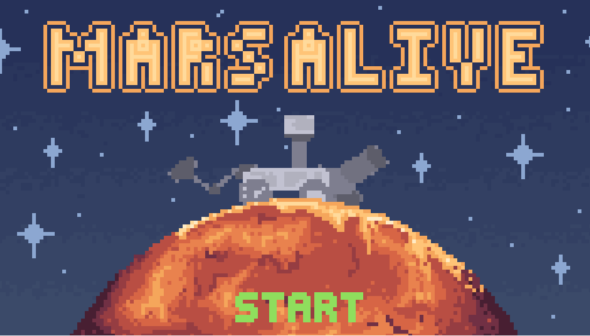
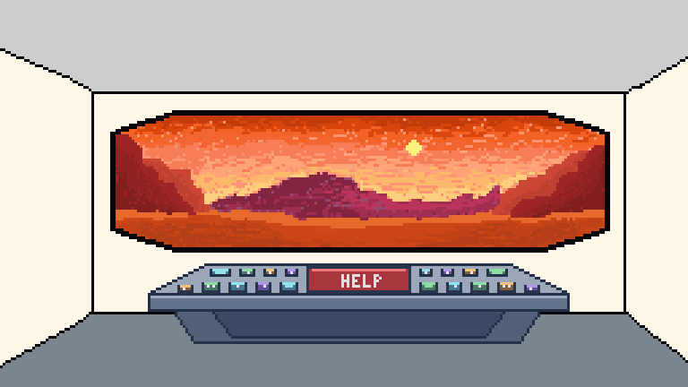

# Nasa Space Apps: Build a Junior Astronaut Mission Trainer
**Mars Alive**

**ABOUT THE TEAM**
45 grados is a team of six young women driven by curiosity, engineering, and a shared commitment to STEAM. Created to spark early interest in science and technology, the team works to educate children and youth through accessible and creative learning experiences. At the heart of 45 grados is a clear mission: to make space education welcoming and achievable for young minds everywhere. 

**GAME DEMO**
Click here to watch the game demo video: 

**Play the Game Demo (itch.io)**
You can play Mars Alive directly without installing Unity via itch.io page:
Play Online: [Add your itch.io link here]

**How to Launch & Play**
1- Open the itch.io link above.

2- Click "Run Game", wait for the Unity loader to finish, and click the full-screen icon in the bottom-right corner for the best 8-bit view.

3- Controls: Use Left-Click (Point-and-Click) to navigate outpost rooms, interact with Greenhouse crops and check the RadLab radiation monitor.

## Repository Content & Structure

Mars-Alive/
├── AI Use/                    # Prompts, AI workflow logs, and disclosure documentation
├── Code/                      # C# scripts and Unity source logic (Sol cycle, resources, Greenhouse, RadLab)
├── DEMO/                      # Pitch presentation slides and demo materials
├── GAME/                      # Playable game files / build resources (also hosted on itch.io)
├── Images/                    # Custom 8-bit pixel art sprites, UI elements, and HUD assets (Pixel Studio)
├── Technical documentation/   # Scientific research, curated NASA RadLab dataset, and APA 7th references
└── README.md                  # Main project overview, gameplay flow, and setup instructions

### Folder Descriptions
* **AI Use/:** Contains the tentative and refined prompts used with Claude AI and Unity's AI Assistant to generate base C# scripts, along with transparency notes.
* **Code/:** Stores the C# scripts governing the 30-Sol survival loop, Energy/Water/Health variables, mandatory sleep mechanics, and the RadLab data reader.
* **DEMO/:** Includes the official hackathon presentation slides and showcase assets.
* **GAME/:** Contains the playable build files and executable/WebGL package for running *Mars Alive*.
* **Images/:** Houses all original 8-bit pixel art created in Pixel Studio, including outpost rooms, greenhouse crop growth stages, radiation alerts, and the 9-piece puzzle.
* **Technical documentation/:** Holds the scientific background for the 9 discovery missions, the curated May 1–30, 2023 NASA RadLab dataset, ISS Veg-04A notes, and full APA 7th edition references.
* **README.md:** Main documentation hub with gameplay instructions, itch.io launch steps, and project details.

**PROJECT SUMMARY**
Space education for children is often very limited due to being either too technical for them to understand or so simple that it overlooks core information. Our goal is to bridge the gap between accurate representations of astronauts' experiences and dynamic experiences children are willing to play. Children need this type of information to discover the potential of the STEAM field, in a way that’s realistic but still exciting. Our solution? Mars Alive, the 8-bit point-and-click survival game aimed for children aged 7 to 12 that aims to teach players about the necessary conditions and tasks needed to sustain life on Mars while utilizing data from actual instruments and curated databases (ISS Veg-04A y NASA RadLab). Built in Unity with AI-assisted coding workflows (Claude AI) and custom 8-bit art created in Pixel Studio.

## Visual Preview
| Outpost & 8-Bit HUD | ISS Veg-04A Greenhouse | RadLab Radiation Monitor |
| :---: | :---: | :---: |
|  |  | ) |

**PROJECT DETAILS**
**Goal:** The objective of Mars Alive is for the player to look for clues that may prove past life existed on Mars. With each mission they accomplish, they receive a piece of a puzzle that takes them closer to their goal. 
Our game is based on 5 main variables that dictate its flow: Sol (Martian days), puzzle pieces, energy, water, and health. The first one, Sols, are Martian days that in real life take 24 h and 39 min. In the game, however, each Sol is 10 minutes long. Once the 10 minutes are over and the character goes to sleep, the game advances to the next Sol. Next, puzzle pieces are the main indicator of the progress toward achieving our goal. For each mission completed, the player receives one piece of the puzzle; once the 9-piece puzzle is completed, the mission results in victory. Finally, we have energy, water, and health. They can all be consumed or recharged through actions. 
**Data:** 
*ISS Veg-04A (Greenhouse):* Our demo utilizes data from NASA´s ISS Veg-04A experiment to explain the process of space agriculture from inside the Greenhouse. As well as curated data accessible from the Control Center, spanning from May 1 to May 30 2023 extracted from the RadLab database. 

*NASA RadLab (Control Center):* RadLab is utilized to display real Martian surface radiation levels inside the Control Center 

*9 missions (discovery of life):* The nine missions in Mars Alive trace NASA's real scientific timeline of clues pointing toward ancient life on Mars. Players first uncover evidence of past liquid water through rounded conglomerate rocks from an ancient streambed discovered by Curiosity in Gale Crater (2012), freshwater clay drilled from the "John Klein" rock (2013), and subsurface water ice dug up near the Martian north pole by the Phoenix lander (2008). Next, they investigate Mars's ancient atmosphere and chemistry through trapped gases analyzed by Curiosity and MAVEN, baked Martian soil revealing the essential chemical building blocks of life—carbon, hydrogen, nitrogen, oxygen, phosphorus, and sulfur—and iron- and sulfur-rich minerals that sustain underground, non-photosynthetic microbes on Earth. The final clues bring players to Perseverance's 2024 discovery of "Cheyava Falls"—a rock marked with leopard-like spots associated on Earth with microbial energy extraction—alongside astrobiology research showing that hardy Earth microbes and lichens can survive harsh space radiation and Martian conditions, culminating in Mission 9: securing sealed Martian rock sample tubes for return to Earth so advanced laboratories can definitively confirm whether life once existed on the Red Planet.

**Módulos en UNITY:**

**Game flow:** 
*Mission Start:* The player starts at the Martian outpost with water, energy, and health at 100%, a clock that indicates whether it is time to sleep, and the objective to complete a puzzle of 9 scientific missions about past life on Mars. 

*Environmental and status check:* At the start of each sol, the player checks their resources bar and the RadLab radiation monitor tab to see whether surface radiation is normal. 

*Daily decisions:* Using point-and-click controls, the player interacts with outpost stations—such as the playable ISS Veg-04A Greenhouse—deciding whether to spend scarce Water and Energy to grow lettuce and potatoes for Health recovery or save those resources for scientific lab missions.

*Mandatory Sleep & Cycle Update:* To end each day, the player must sleep. This mandatory action advances the Sol counter and loads the next real RadLab data entry.

*Mission Resolution:* The loop continues until the player solves all 9 scientific missions within 30 Sols or any vital resource drops to zero.

**Results:** 
*8-Bit HUD:* Real-time bars for Energy, Water, Health, and the Sol counter, designed for rapid visual comprehension by children aged 7–12.
RadLab Monitor Tab: Displays a dynamically updating numerical readout and color-coded radiation alert based on the curated May 2023 NASA RadLab dataset.

*Visual & Puzzle Progression:* Features real-time sprite changes in greenhouse crops (from seedling to harvest) and the progressive unlocking of the 9-piece scientific puzzle.

*Mission Pacing & Completion Outcomes:* Most actions required to advance a mission consume a specific percentage of Energy, Water, or Health, scaled to the difficulty of each task. If a player does not complete an active mission within 3 Sols, the next mission remains locked until the current one is finished. Completing each main mission awards one puzzle piece, and finishing the ninth and final mission reveals the complete puzzle—marking mission victory.

**USE OF AI**
Our team designed the core game mechanics, scientific logic, and pixel art manually, using AI tools strictly to accelerate C# code generation in Unity. First, we drafted initial functional specifications and tentative prompts based on our game rules. Next, we used Claude AI to refine and structure those prompts into clear technical instructions. Finally, we fed those refined prompts into Unity's AI Assistant to generate the base scripts, which our team then reviewed, adjusted, and integrated into the project.

**NASA DATA**
The datasets and scientific resources utilized in our current demo include:

*ISS Veg-04A:* A 2019 International Space Station experiment aimed at proving that crops such as red romaine lettuce and tomatoes can be successfully grown in space, used to model our playable Greenhouse mechanics.

*NASA RadLab:* An open database and analysis tool containing curated and live radiation data across celestial bodies. For our project, we integrated May 2023 surface radiation data captured by the RAD (Radiation Assessment Detector) instrument aboard NASA's Curiosity rover.

*Space Radiation Analysis Group (Johnson Space Center):* Their Frequently Asked Questions publication served as our foundational guide to understanding space radiation and how it is measured.

*Jet Propulsion Laboratory (JPL):* Technical publications and mission reports from JPL gave us a better understanding of how Mars rovers operate and are constructed.

**Future Modular Expansion:**
In future iterations, we plan to implement additional outpost rooms integrating data and mechanics from the following NASA tools:
*DONKI (Space Weather Database Of Notifications, Knowledge, Information):* A comprehensive space weather database that will allow us to simulate real solar flares and coronal mass ejections affecting the Martian atmosphere.

*SHERLOC (Scanning Habitable Environments with Raman & Luminescence for Organics & Chemicals):* Mounted on the end of the Perseverance rover's robotic arm, this instrument uses an ultraviolet laser to detect organic compounds and minerals that may preserve signs of past microscopic life.

*PIXL (Planetary Instrument for X-ray Lithochemistry):* Also on Perseverance's robotic arm, PIXL focuses a hair-thin X-ray beam closely onto rock surfaces to map elemental chemistry and identify potential biosignatures of ancient microbial life.

**SPACE AGENCY PARTNER & OTHER DATA**
To enrich our educational design with insights from international space agency partners, we incorporated resources from the Canadian Space Agency (CSA):
*Canadian Space Agency (CSA):* We used their Educators and Youth Toolkit on Food Production on the Moon and Remote Areas to inform the educational mechanics and crop-management concepts behind our playable Greenhouse module.

> *"With **Mars Alive**, we don't just teach children about space—we put them in command of real NASA science, proving that the next generation of explorers is ready to keep Mars alive."*  
> — **Team 45 Grados**

